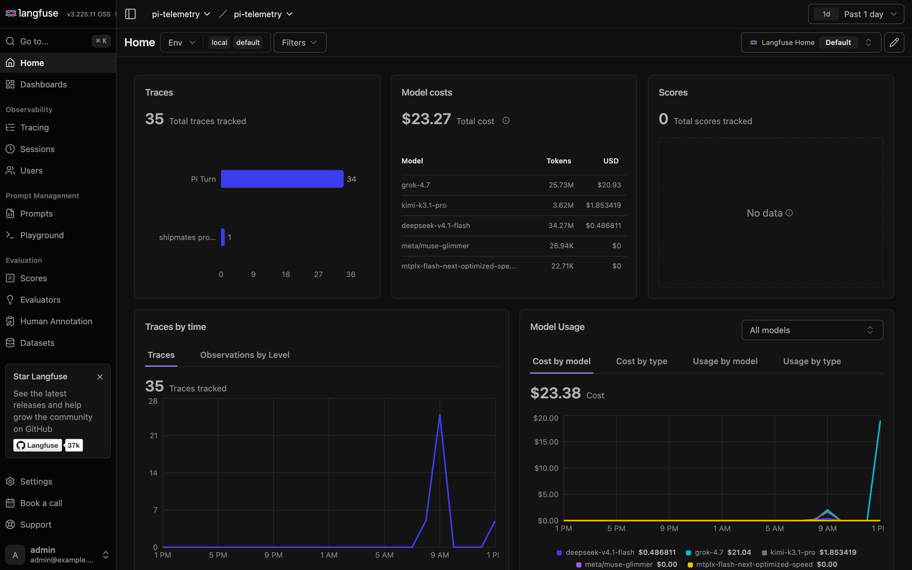

# langfuse-k8s-gitops



General-purpose **ArgoCD + Helm** deployment repository for self-hosting **Langfuse** (v3/v4 architecture) inside a single Kubernetes namespace across any cluster (`local`, `test`, `pre-prod`, and `prod` AWS accounts).

---

## Architecture Overview

This repository packages an umbrella Helm chart ([`charts/langfuse-stack`](charts/langfuse-stack/Chart.yaml)) that wraps the official upstream [`langfuse/langfuse`](https://github.com/langfuse/langfuse-k8s) Helm chart (`v2.1.7`) and solves the key operational challenges of deploying Langfuse in a single Kubernetes namespace via ArgoCD:

1. **ArgoCD-Safe Unified Secret Pinning**:
   Upstream `langfuse` uses Helm's `lookup` function to auto-generate unpinned secrets on install. Because ArgoCD renders manifests offline using `helm template`, unpinned secrets would rotate on every sync—breaking `SALT` (API key hashes) and `ENCRYPTION_KEY`. This chart pins all credentials to a single unified Secret (`langfuse-secrets`), populated either by **External Secrets Operator (ESO)** from AWS Secrets Manager (`test`, `pre-prod`, `prod`) or automatically in `local`.
2. **Single-Namespace Containment (Zero Cluster-Wide CRD Requirement)**:
   Upstream `langfuse` v2+ defaults to `ClickHouseCluster` CRs that require cluster-wide `clickhouse-operator` and `cert-manager` CRDs. To keep this deployment 100% self-contained in a single namespace (`langfuse`), `charts/langfuse-stack` includes a built-in `standaloneClickhouse` StatefulSet (`clickhouse/clickhouse-server:25.12`) alongside the bundled PostgreSQL, Valkey (Redis), and SeaweedFS (S3) stores. Any backing store can also be toggled off (`deploy: false`) in favor of AWS RDS, ElastiCache, S3 (IRSA), or ClickHouse Cloud.
3. **Headless First-Boot Provisioning**:
   Auto-provisions the initial organization, project, admin user, and API keys (`LANGFUSE_INIT_*` and `ADMIN_API_KEY`) on first boot so telemetry clients (such as `@langfuse/pi-observability-plugin` or OpenTelemetry SDKs) work immediately without manual UI clicks.
4. **Flexible Ingress & Gateway API**:
   Supports both standard Kubernetes `Ingress` (e.g., AWS Load Balancer Controller ALB) and Kubernetes Gateway API (`HTTPRoute`).

---

## Repository Structure

```text
langfuse-k8s-gitops/
├── Makefile                              # Helper commands for deps, linting, rendering, and secret generation
├── argocd/
│   ├── appproject.yaml                   # ArgoCD AppProject scoped to the `langfuse` namespace
│   ├── applicationset.yaml               # Multi-cluster ApplicationSet (central ArgoCD hub option)
│   └── applications/
│       ├── local.yaml                    # ArgoCD Application for local K8s clusters
│       ├── test.yaml                     # ArgoCD Application for the Test AWS account cluster
│       ├── pre-prod.yaml                 # ArgoCD Application for the Pre-Prod AWS account cluster
│       └── prod.yaml                     # ArgoCD Application for the Prod AWS account cluster
├── charts/
│   └── langfuse-stack/
│       ├── Chart.yaml                    # Umbrella chart wrapping upstream `langfuse/langfuse` (v2.1.7)
│       ├── values.yaml                   # Default values (single-namespace stack)
│       └── templates/
│           ├── _helpers.tpl              # Template helpers
│           ├── bootstrap-configmap.yaml  # Headless org/project/user initialization ConfigMap
│           ├── clickhouse-service.yaml   # Single-namespace ClickHouse ClusterIP Service
│           ├── clickhouse-statefulset.yaml # Single-namespace ClickHouse 25.12 StatefulSet
│           ├── external-secret.yaml      # ExternalSecret (AWS Secrets Manager -> K8s Secret)
│           ├── httproute.yaml            # Kubernetes Gateway API HTTPRoute
│           ├── networkpolicy.yaml        # Namespace-scoped datastore NetworkPolicy
│           └── secret.yaml               # In-cluster Secret generator (for `local` quickstart)
└── environments/
    ├── local/values.yaml                 # Local K8s (Kind / Minikube / Docker Desktop / OrbStack)
    ├── test/values.yaml                  # Test AWS account cluster (1 cluster, `langfuse` namespace)
    ├── pre-prod/values.yaml              # Pre-Prod AWS account cluster (HPA, PDB, `gp3` / external stores)
    └── prod/values.yaml                  # Prod AWS account cluster (HA 3+ replicas, multi-AZ, `gp3` / external stores)
```

---

## Environment Matrix

Each AWS environment (`test`, `pre-prod`, `prod`) runs in its own AWS account with 1 EKS cluster, and the entire Langfuse stack lives in a single namespace (`langfuse`):

| Environment | Overlay File | Secrets Source | Web / Worker Replicas | Backing Stores Default |
| :--- | :--- | :--- | :--- | :--- |
| **`local`** | [`environments/local/values.yaml`](environments/local/values.yaml) | Chart-created `Secret` (`secrets.create: true`) | `1` / `1` | In-namespace StatefulSets |
| **`test`** | [`environments/test/values.yaml`](environments/test/values.yaml) | AWS Secrets Manager (`langfuse/test/secrets`) via ESO | `1` / `1` | In-namespace StatefulSets (`gp3`) |
| **`pre-prod`** | [`environments/pre-prod/values.yaml`](environments/pre-prod/values.yaml) | AWS Secrets Manager (`langfuse/pre-prod/secrets`) via ESO | `2–4` (HPA + PDB) | In-namespace `gp3` or external RDS/S3/ElastiCache |
| **`prod`** | [`environments/prod/values.yaml`](environments/prod/values.yaml) | AWS Secrets Manager (`langfuse/prod/secrets`) via ESO | `3–10` (HPA + PDB + AZ spread) | In-namespace `gp3` (`Retain`) or external RDS/S3/ElastiCache |

---

## Quick Start

### 1. Pull Chart Dependencies

Requires Helm `v3.17+` (or Docker, which the `Makefile` uses automatically if `helm` is not on your `PATH`):

```bash
make deps
```

### 2. Provision Secrets in AWS Secrets Manager (`test`, `pre-prod`, `prod`)

Generate a complete, cryptographically random JSON payload for AWS Secrets Manager:

```bash
make generate-secrets
```

Store the resulting JSON in each AWS account's Secrets Manager under:
- **Test account**: `langfuse/test/secrets`
- **Pre-Prod account**: `langfuse/pre-prod/secrets`
- **Prod account**: `langfuse/prod/secrets`

When ArgoCD syncs the chart, the `ExternalSecret` resource (annotated with `argocd.argoproj.io/sync-wave: "-1"`) materializes the `langfuse-secrets` Kubernetes `Secret` in the `langfuse` namespace before the application and datastore pods start.

> **Alternative (Without External Secrets Operator):**
> If a cluster does not run External Secrets Operator, set `externalSecret.enabled: false` in `environments/<env>/values.yaml` and pre-create the `langfuse-secrets` `Secret` in the `langfuse` namespace directly.

### 3. Deploy via ArgoCD

#### Option A: Per-Account Spoke ArgoCD (1 ArgoCD per AWS Account Cluster)

Apply the `AppProject` and the environment's `Application` manifest inside that cluster:

```bash
# First, update `spec.source.repoURL` in argocd/applications/<env>.yaml to your Git remote
kubectl apply -f argocd/appproject.yaml
kubectl apply -f argocd/applications/test.yaml      # on Test cluster
kubectl apply -f argocd/applications/pre-prod.yaml  # on Pre-Prod cluster
kubectl apply -f argocd/applications/prod.yaml      # on Prod cluster
```

#### Option B: Central Hub ArgoCD (`ApplicationSet`)

If a central ArgoCD instance manages all three AWS account clusters:

```bash
kubectl apply -f argocd/appproject.yaml
kubectl apply -f argocd/applicationset.yaml
```

### 4. Local Kubernetes Deployment (Direct Helm or Local ArgoCD)

To spin up the full stack in Docker Desktop Kubernetes, Kind, Minikube, or OrbStack:

```bash
helm upgrade --install langfuse charts/langfuse-stack \
  --namespace langfuse --create-namespace \
  -f charts/langfuse-stack/values.yaml \
  -f environments/local/values.yaml
```

Then port-forward and verify health:

```bash
kubectl port-forward -n langfuse svc/langfuse-web 3000:3000
curl http://localhost:3000/api/public/health
```

---

## Using External AWS Managed Services (RDS, ElastiCache, S3)

In `pre-prod` or `prod`, you can switch any of the in-namespace backing stores to managed AWS services in `environments/<env>/values.yaml`:

```yaml
langfuse:
  langfuse:
    serviceAccount:
      annotations:
        eks.amazonaws.com/role-arn: arn:aws:iam::<ACCOUNT_ID>:role/langfuse-s3-role
  postgresql:
    deploy: false
    host: "langfuse-db.cluster-xxxx.us-east-1.rds.amazonaws.com"
  redis:
    deploy: false
    host: "langfuse-valkey.xxxx.ng.0001.use1.cache.amazonaws.com"
    tls:
      enabled: true
  s3:
    deploy: false
    bucket: "langfuse-prod-traces"
    region: "us-east-1"
    forcePathStyle: false
```

---

## Validation & Local Rendering

Lint and render Kubernetes manifests offline for all four environments (`local`, `test`, `pre-prod`, `prod`):

```bash
make validate
```

Rendered manifests are written to `rendered/{local,test,pre-prod,prod}.yaml` (gitignored).
